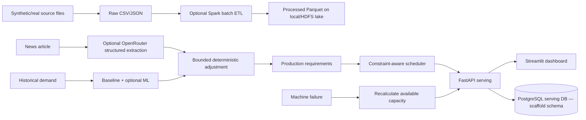

# Architecture and deployment stages

The default application is intentionally light enough for a laptop. The optional OR-Tools CP-SAT scheduler enforces compatibility, non-overlap, work-hour capacity and material bounds; without OR-Tools a greedy fallback runs. To expand to the requested full data platform, add Kafka topics (`orders`, `machine_events`, `inventory_updates`, `production_events`, `maintenance_events`, `news_events`), Spark Structured Streaming with event-time watermarks/checkpoints, HDFS raw/processed/curated zones, and Airflow batch orchestration. Keep PostgreSQL as the serving store, not the data lake. The current scheduler does not yet model maintenance intervals, sequence-dependent changeovers or due-date objectives. For production use, add authentication, migrations, durable transactional state, secret management and observability.

## Provenance and status

Current demand/orders/sensors are generated/simulated. Event adjustment rule is capped at ±25% overall and per event has max magnitude 12% before relevance/confidence weighting. No external news API or live LLM calls occur by default. API in-memory simulation state resets at restart. Docker Compose only starts API/dashboard/Postgres; it does not claim the remaining distributed stack is active.
